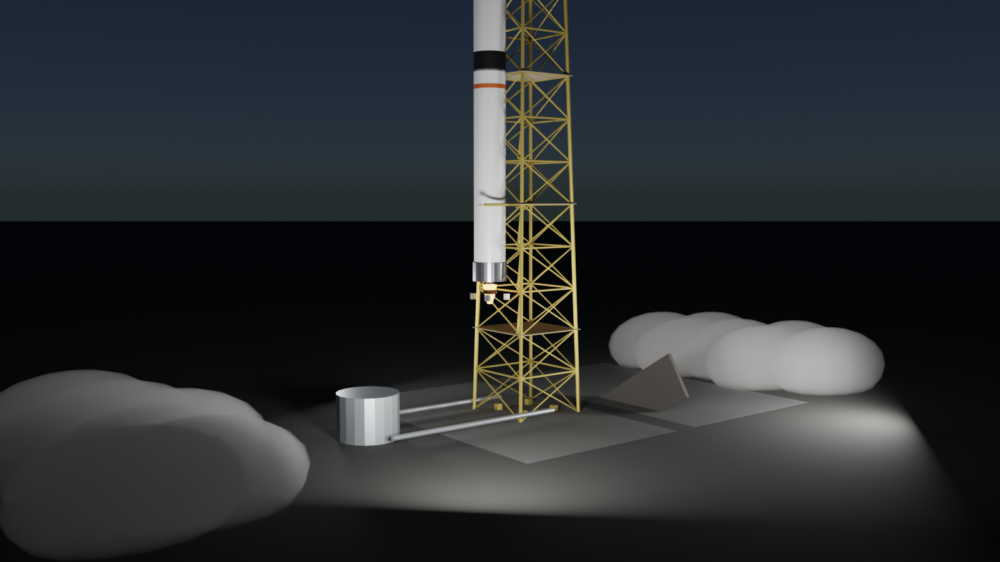
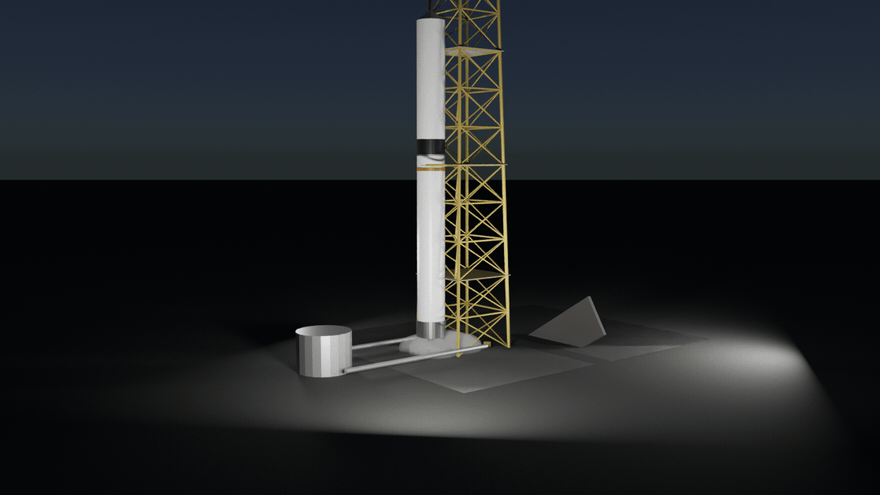

# 🌌 orbit-cinema

**EN:** The **launch**: pad-cinema's complex + rocket-cinema's functional two-stage vehicle, lifting off at night under a real ascent simulation. The hold-downs release at t = 0.9 s, then altitude comes straight from the integrated flight ODE — the rocket rises exactly as fast as its thrust, mass flow and gravity say. Ground steam pours from the flame trench, the plume light pools on the pad, floodlights hold the tower.

**TR:** **Fırlatış**: pad-cinema'nın kompleksi + rocket-cinema'nın fonksiyonel iki kademeli aracı, gerçek yükseliş simülasyonuyla gece yarısı havalanıyor. Klepeler t = 0.9 s'de açılıyor, irtifa doğrudan uçuş ODE'sinden geliyor — roket, itkisinin + kütle akışının + yerçekiminin dediği kadar hızlı yükseliyor. Yer buharı alev kanalından akıyor, plume ışığı pada havuzlanıyor, projektörler kuleyi tutuyor.



## 🖼️ Gallery / Galeri

### 🌙 Gece fırlatışı

t = 2.6 s: 14 m up, steam rolling along the pad, plume glow under the stack. — *t = 2.6 s: 14 m yükseklikte, buhar padde yuvarlanıyor, plume ışığı yığının altında.*

### 🎬 Fırlatma animasyonu

*48 frames: ignition → hold-down release → climb. Altitude = flight ODE, not easing curves.*

## 🧱 How it works / Nasıl çalışır

```
rocket-cinema/roket_fizik.ucus_sim()  →  z(t) interpolasyonu
        ↓
pad-cinema  →  kule + servis kollari + alev kanali + su hatti
        ↓
roket kok'unun z'si her karede sim'den gelir; yer buharı
alev kanalindan iki yana, hacimsel (VolumePrincipled)
```

## ✅ Verification / Doğrulama

```bash
python3 tests/verify.py
```

- **Hold-down gate**: z = 0 exactly until t = 0.9 s
- **Ascent gate**: monotonic climb after release (z(6 s) = 126.6 m)
- **TWR gate**: 1.52 > 1
- **Symmetry gate**: tower lattice equidistant corners
- **Apogee gate**: sim apogee 617 km

## 🚀 Usage / Kullanım

```bash
# kardeş repolar yan yana olmalı
git clone https://github.com/efealtiparmakoglu/pad-cinema
git clone https://github.com/efealtiparmakoglu/rocket-cinema
git clone https://github.com/efealtiparmakoglu/orbit-cinema

blender --background --python firlatma.py -- --scene scenes/gece_firlatma.json
HIZLI=1 blender --background --python firlatma.py -- --scene scenes/gece_firlatma.json
blender --background --python firlatma.py -- --scene scenes/firlatma.json --gif 48 --fps 12
```

## 🧪 Why / Neden

**TR:** Üçlemenin finali cevaptır: hattı olmayan tren, rampası olmayan roket — eksik kalır. Ve fırlatış, yüksekliği "yavaş-yavaş-hızlı" diye eğri çizmek değil; itki kütle yakar, yakalanan kütle ivmeyi değiştirir, değişen ivme gökyüzünü yazar. Bu repoda gökyüzü, denklemin çıktısıdır.

## 📄 License

MIT
